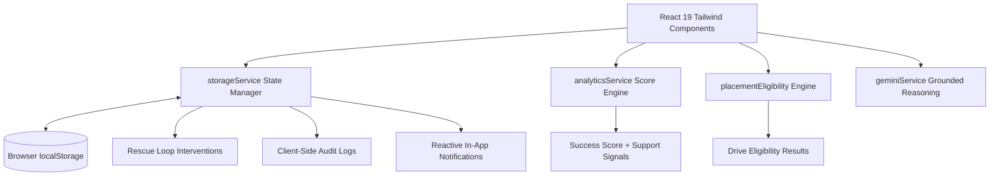

# CampusIQ — Campus Rescue Loop
> **Closed-Loop Student Success & Academic Intervention Platform**  
> *A grounded, evidence-based system for mentors and students to detect academic distress, co-create actionable recovery plans, track milestones, and measure verifiable outcomes.*

---

## 🎯 Target Problem & Users

College advising systems typically suffer from **dashboard fatigue** and **broken intervention loops**:
- Advising platforms show alerts ("Attendance drop: 62%") but provide no shared workspace to agree on concrete recovery commitments.
- Interventions are logged as static notes without baseline metric snapshots, milestone tracking, or before-and-after outcome comparisons.
- Students receive punitive notifications without actionable recovery pathways or transparent mathematical explanations of their status.

### Target Personas
1. **Academic Mentors (e.g., Dr. Shweta Rao):** Reviews mentee records, explains dated attendance signals, simulates attendance recovery targets, and co-creates support plans.
2. **Students (e.g., Neha Patel, Aarav Sharma):** Understands exactly how their success score is calculated, checks placement drive criteria, updates recovery milestones, and adds weekly reflections.
3. **Faculty & HODs:** Manages attendance sessions and assignment evaluations with scoped departmental authorization.
4. **Placement Coordinators:** Configures corporate recruitment drives with automated, criterion-by-criterion eligibility filtering across CGPA, active backlogs, and allowed branches.

---

## 💡 One-Sentence Solution

**Campus Rescue Loop** transforms passive academic alerts into a transparent, closed-loop recovery workflow—combining mathematically explainable success scores, an interactive attendance scenario simulator, and shared mentor-student recovery plans with verifiable before/after outcome tracking.

---

## 🔍 Feature Status: Implemented vs. Simulated vs. Future Work

| Capability | Status | Implementation Details |
| :--- | :--- | :--- |
| **Grounded Success Score Engine** | ✅ **Implemented** | Six-factor nominal weighting: academic 35%, attendance 20%, LMS activity 15%, engagement 10%, skills 10%, and placement preparation 10%. Missing factors are excluded and the total is normalized over available weights; coverage below 70% is marked provisional. |
| **Campus Rescue Loop (Interventions)** | ✅ **Implemented** | Shared plans include baseline snapshots, dated milestones, student progress updates, mentor check-ins, plan revisions, and observed before/after comparisons. Seeded Neha Patel example: 51.5% baseline attendance (late counts at 0.7) and 65.0% across 18 observed sessions through Oct 12. |
| **Attendance "What If?" Simulator** | ✅ **Implemented** | Deterministic mathematical calculation of future sessions needed to reach 75% or 85% attendance, explicit assumptions, and a 1-click "Turn into Milestone" action. |
| **Dynamic Placement Eligibility** | ✅ **Implemented** | Central `checkPlacementEligibility()` engine checking drive requirements (`minCgpa`, `maxBacklogs`, `departments`) dynamically across all drives without hardcoded columns. |
| **Client-Side Reactive Persistence** | ✅ **Implemented** | Fully runnable offline via browser `localStorage` (`campusiq_state_v1`). Emits reactive events to keep all views synchronized in real time. |
| **Role-Specific Demo Views** | ✅ **Implemented (Demo Only)** | 8 personas with switchable dashboards. This is a client-side demo, not authentication or server-enforced authorization. |
| **Role-Aware Leadership Directory** | ✅ **Implemented (Demo Only)** | Super administrators can browse all demo users; other roles can view and contact super administrators. Directory visibility is a client-side prototype rule, not production authorization. |
| **Local Grounded Recommendations** | ✅ **Implemented (Deterministic)** | Recommendations are generated locally from available student records; no AI provider or API key is required. |
| **Interactive Acceptance Check Panel** | 🟡 **Demo Aid** | Provides an interactive checklist with sample checks. It is not a security test suite and does not establish authentication, authorization, or production readiness. |
| **Firestore Schema Preview** | 🟡 **Illustrative** | A modeled collection/schema view is available in the UI; the application does not connect to Firestore. |
| **Live Backend Synchronization** | ⏳ **Future Work** | Server-side Firebase Firestore rules enforcement, real-time WebSocket sync across multiple physical devices, and automated SIS/ERP database webhooks. |
| **Cloud AI Gateway** | ⏳ **Future Work** | Backend proxy with OAuth token exchange, differential privacy filtering, and enterprise Gemini 1.5 Pro API calls. |

---

## 👥 Demo Personas

| Name | Role | ID | Primary Use Case in Demo |
| :--- | :--- | :--- | :--- |
| **Dr. Shweta Rao** | Academic Mentor | `user-mentor-1` | Starts in the Rescue Loop view with Neha Patel selected; reviews evidence, runs the scenario, and checks plan milestones. |
| **Neha Patel** | Student (Support Loop) | `user-student-2` (`stu-102`, `21CS078`) | Seeded support case: CGPA 6.35, one backlog, and an attendance recovery plan. |
| **Aarav Sharma** | Student (Comparison) | `user-student-1` (`stu-101`, `21CS042`) | Comparison profile: CGPA 8.78 and no backlogs. |
| **Ms. Priya Deshmukh** | Placement Officer | `user-placement-admin-1` | Reviews seeded company drives and eligibility reasons. |
| **Prof. Rajesh Verma** | Faculty Member | `user-faculty-1` | Demonstrates attendance and assignment workflows. |
| **Dr. Evelyn Vance** | Super Admin | `user-super-admin` | Opens the local demo administration and schema-preview view. |

---

## ⏱️ 2-Minute Walkthrough Script

Follow these steps for an end-to-end evaluation of the core rescue loop:

### Step 1: Open the App in Demo Mode (0:00 – 0:20)
1. Launch the app (`http://localhost:5173/`).
2. On the **Login Page**, click the **Academic Mentor** quick-login card (Dr. Shweta Rao).
3. The app opens directly into the **Mentor Workspace**.

### Step 2: Spot the Student in Need of Support (0:20 – 0:50)
1. Neha Patel (`21CS078`) is selected by default in the mentor view.
2. Review her success score explanation and the dated attendance records behind the support prompt.
3. Attendance moved from six present sessions out of six in early September to a weighted 51.5% across 13 sessions through Oct 07 (six present, one late weighted at 0.7, and six absent).

### Step 3: Run the "What If?" Scenario & Inspect Shared Plan (0:50 – 1:20)
1. Look at the **Attendance Recovery Scenario ("What If?")** card.
2. Set the "sessions ahead" control to **8**. The scenario shows about **75.8%** if Neha attends all eight future sessions; the card labels this as a hypothetical scenario.
3. Click **"Turn into Plan Milestone"** to see it added as a concrete target.
4. Review the **Active Support Plan (Campus Rescue Loop)** card:
   - **Baseline Snapshot:** 51.5% weighted attendance across 13 sessions before the plan began.
   - **Current Observed:** 65.0% weighted attendance across 18 sessions through Oct 12 (+13.5 percentage points).
   - Review the completed milestones and toggle an upcoming milestone, such as joining the peer-assisted tutorial circle.
   - Read the seeded student progress update and mentor check-in note.

### Step 4: Verify Student Self-Service View (1:20 – 1:40)
1. Use the **Role Switcher** in the top navigation bar to switch to **Student (Neha Patel)**.
2. Scroll to her **Active Academic Support Plan** section:
   - Notice Neha can check off her own milestones and submit a new weekly reflection.
   - She can interact with her personal Attendance Scenario simulator.
3. Switch role to **Aarav Sharma (Student)**:
   - Notice Aarav's healthy score (86/100), absence of distress alerts, and placement eligibility overview.

### Step 5: Verify Placement Eligibility & Acceptance Suite (1:40 – 2:00)
1. In the top bar, switch to **Placement Officer** (Ms. Priya Deshmukh).
2. Observe how company cards (Google, Microsoft, Infosys, Cognizant) dynamically calculate eligibility:
   - Aarav is fully eligible for top-tier drives.
   - Neha is below the Microsoft CGPA cutoff (6.35 < 7.50) and has one backlog while the drive allows zero.
3. The **Acceptance Checks** panel is a demo aid; its checks are illustrative and do not establish production security or authorization.

---

## 🛠️ Installation & Running Locally

### Prerequisites
- Node.js 18+ (tested on Node.js 20 & 22)
- npm 9+

### Commands
```bash
# 1. Install dependencies
npm install

# 2. Start the local Vite development server
npm run dev

# 3. Build for production and verify TypeScript compliance
npm run build

# 4. Preview the production build locally
npm run preview
```

The application runs at `http://localhost:5173/` by default.

---

## 🏗️ Architecture & Data Flow



### 1. Client-Side State & Persistence (`src/services/storageService.ts`)
- Manages 18 normalized collections in memory with auto-serialization to `localStorage` under the key `campusiq_state_v1`.
- Emits subscriber change events on every state mutation so UI widgets update reactively without page reloads.
- Contains a 1-click **Reset Demo Data** option in the navbar to return to fresh default seed data at any time.

### 2. Analytics & Explainability Engine (`src/services/analyticsService.ts`)
- **Formula:**
  $$\text{Total Score} = 0.35 \times \text{Academic} + 0.25 \times \text{Attendance} + 0.15 \times \text{LMS} + 0.15 \times \text{Skills} + 0.10 \times \text{Placement}$$
- Calculates exact **data coverage percentage**. When data availability falls below 70%, the score is prominently marked as **Provisional**.
- Session deduplication prevents inflated counts for multiple attendance entries on the same date/class.
- Emits dated, non-punitive `SupportSignal` review prompts rather than generic alert banners.

### 3. Dynamic Placement Engine (`src/services/placementEligibility.ts`)
- Evaluates individual student credentials against dynamic placement drive rules:
  - Minimum CGPA threshold (`minCgpa`).
  - Active backlog limit (`maxBacklogs`).
  - Allowed degree departments (`departments`).
- Provides itemized criteria breakdowns explaining why an applicant is eligible or what criteria remain unmet.

### 4. Local Grounded Recommendations (`src/services/geminiService.ts`)
- Uses deterministic local rules and does not call an AI provider.
- Recommendations reference the student score components and profile fields available to the demo.
- No provider API key is needed for the feature.

---

## 🔒 Security, Privacy & Limitations

1. **Demo Mode:** This application runs entirely client-side using synthetic mock data. It does not connect to live institutional databases or external identity providers.
2. **Local Storage:** All student plans, check-ins, and grades persist inside the browser's `localStorage`. Clearing browser data will reset modifications to the initial seed state.
3. **Audit Logging:** Administrative and mentoring actions append timestamped audit entries to the client-side audit log. In production, this would be backed by an append-only cloud ledger.
4. **Advisory Decision Support:** All calculated scores, support signals, and scenario projections are strictly decision-support tools meant to facilitate human mentor-student conversations, not automated gatekeepers.

---

## 📄 License
No open-source license has been added; the repository is shared for hackathon judging and review.

## 🚀 Deployment

The repository includes a GitHub Actions workflow that builds the Vite app and deploys the `dist` output to GitHub Pages when changes are pushed to `main`. In the repository settings, enable **Pages → Build and deployment → Source: GitHub Actions** if it is not enabled automatically. After the first successful workflow run, the project site URL is:

[https://shaikmastan7337-cpu.github.io/campusiq-campus-rescue-loop/](https://shaikmastan7337-cpu.github.io/campusiq-campus-rescue-loop/)

The site is a static client-side demo using fictional seed data and browser-local storage. It has no live backend or real authentication.
